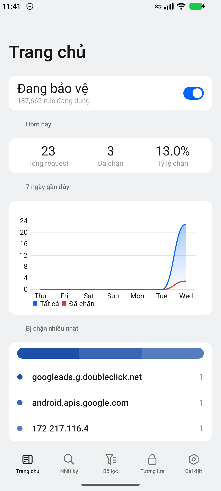
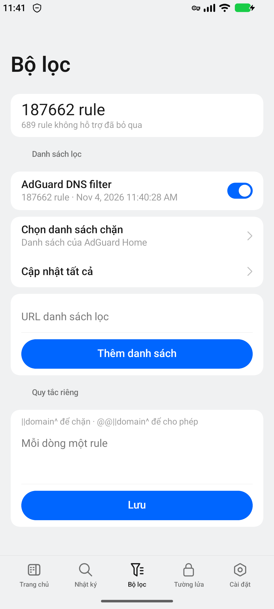
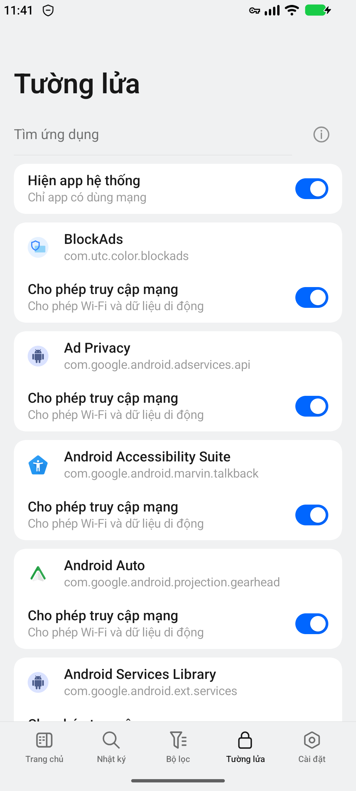

# BlockAds

Chặn quảng cáo và trình theo dõi trên Android bằng VPN cục bộ. **Android 13 trở lên, không cần root.**

## Cài đặt

1. Tải APK tại [bản phát hành mới nhất](https://github.com/ToThangGTVT/coloros-block-ads/releases/latest). Đa số máy dùng **arm64-v8a**; máy ARM 32-bit dùng **armeabi-v7a**.
2. Mở APK và cho phép cài từ nguồn này nếu Android yêu cầu.
3. Mở BlockAds → **Trang chủ** → bật VPN → chấp nhận yêu cầu kết nối VPN.
4. Nếu chưa có bộ lọc, vào **Bộ lọc → Chọn danh sách chặn** để bật danh sách, rồi **Cập nhật tất cả**.

Khi Trang chủ hiện **Đang bảo vệ**, bạn có thể dùng máy bình thường.

## Các mục chính

| Mục | Dùng để |
| --- | --- |
| **Trang chủ** | Bật/tắt bảo vệ, xem số lượt chặn. |
| **Nhật ký** | Xem kết nối, tìm tên miền và chặn/cho phép nhanh. |
| **Bộ lọc** | Chọn, cập nhật danh sách chặn hoặc thêm quy tắc riêng. |
| **Tường lửa** | Cho phép hoặc chặn mạng từng ứng dụng khi VPN bật. |
| **Cài đặt** | Chọn DNS, chỉnh ghi log, sao lưu và kiểm tra cập nhật. |

## Ảnh màn hình

  
  
  

*Ảnh chụp bản 1.0.3 trên máy giả lập Android.*

## Lưu ý

- Chỉ dùng được một VPN cùng lúc. VPN của BlockAds chạy trên máy, không phải dịch vụ đổi IP.
- Không chặn được mọi quảng cáo, chẳng hạn quảng cáo dùng chung máy chủ với nội dung.
- Nếu app bị dừng nền, vào **Cài đặt → Ưu tiên chạy ngầm**. Nếu có cảnh báo Private DNS, tắt DNS riêng trong cài đặt Android để lọc đầy đủ hơn.
- Log/thống kê cập nhật theo lô khoảng 5 giây, có thể sớm hơn khi nhiều kết nối. Lọc HTTPS là tùy chọn nâng cao, mặc định tắt.
- Có thể ẩn phần tử quảng cáo trong Chrome bằng [quy tắc CSS theo website](docs/cosmetic-filtering.md), cần cấu hình lọc HTTPS và cài CA.

Cập nhật tại **Cài đặt → Cập nhật ứng dụng → Kiểm tra cập nhật GitHub**.

[Hướng dẫn build](docs/build.md) · [Thông tin phát hành](docs/releases.md) · [Giấy phép thư viện](THIRD_PARTY_LICENSES.md)
