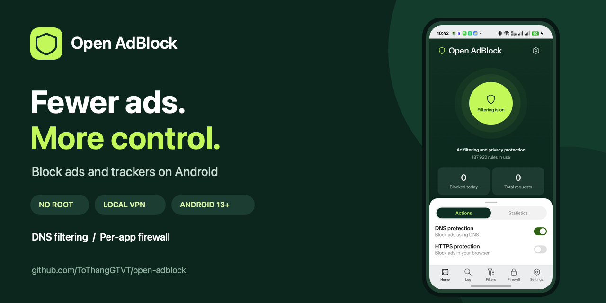

  

# Open AdBlock

Block ads and trackers on Android with a local VPN. **Android 13 or later. No root required.**

  

**Free your screen. Control your connections.** DNS filtering, a per-app firewall, and optional HTTPS filtering in one app, with English and Vietnamese support.

## Installation

1. Download an APK from the [latest release](https://github.com/ToThangGTVT/open-adblock/releases/latest). Most devices use **arm64-v8a**; 32-bit ARM devices use **armeabi-v7a**.
2. Open the APK and allow installation from this source if Android asks.
3. Open Open AdBlock → **Home**, turn on protection, and accept the VPN connection request.
4. If no filter rules are loaded, open **Filters → Choose from catalog**, enable a list, then tap **Update all**.

Once Home shows **Protecting**, you can use your device as usual.

## Main features

| Screen | What you can do |
| --- | --- |
| **Home** | Turn protection on or off and view blocking statistics. |
| **Log** | Inspect connections, search domains, and quickly block or allow them. |
| **Filters** | Choose and update filter lists or add custom rules. |
| **Firewall** | Allow or block network access for individual apps while the VPN is on. |
| **Settings** | Choose a DNS server, configure logging, back up settings, and check for updates. |

## Languages

The app supports **English** and **Vietnamese**. It follows your device language by default and falls back to English for unsupported languages. Change it in **Settings → Appearance → Language**, or in Android's per-app language settings.

## Screenshots

  
  
  

*Captured in English from version 1.1.5 (debug build) on an Android device.*

## Notes

- Android allows only one active VPN at a time. Open AdBlock's VPN runs locally on your device; it does not change your public IP address.
- Some ads cannot be blocked, including ads served from the same servers as the content you want to access.
- If Android stops the app in the background, open **Settings → Keep running in the background**. If a Private DNS warning appears, turn off Private DNS in Android settings for full DNS filtering.
- Logs and statistics update in batches roughly every five seconds, or sooner during heavy traffic. HTTPS filtering is an advanced option and is off by default.
- You can hide ad elements in Chrome using [website-specific CSS rules](docs/cosmetic-filtering.md). This requires HTTPS filtering and an installed CA certificate.

Check for updates in **Settings → App updates → Check GitHub for updates**.

[Build instructions](docs/build.md) · [Release information](docs/releases.md) · [Third-party licenses](THIRD_PARTY_LICENSES.md)

## Repository name

Open AdBlock now lives at **[ToThangGTVT/open-adblock](https://github.com/ToThangGTVT/open-adblock)** (formerly `coloros-block-ads`). If an older app version cannot check for updates after the rename, download the latest APK from Releases and install it over your existing copy. Use the same release signing key; do not uninstall the app to update it.
